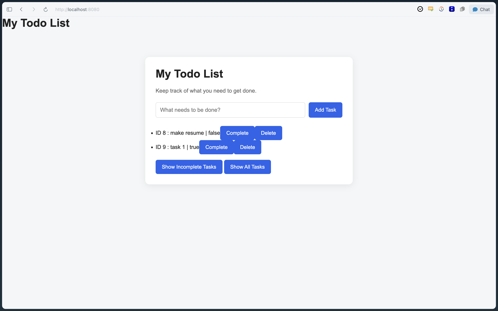
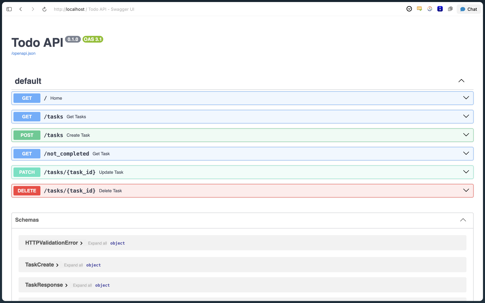
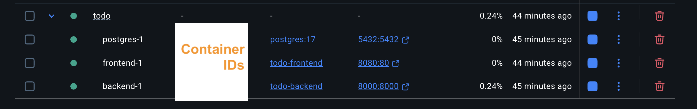

# ☑️ Todo App

A full-stack Todo web application built with **HTML, CSS, JavaScript, Python, FastAPI, PostgreSQL, and Docker Compose**.

The project demonstrates REST API development, relational database integration, frontend-backend communication, and containerized application deployment.

## Features

- Create new tasks.
- Retrieve all tasks.
- Filter incomplete tasks.
- Mark tasks as completed or incomplete.
- Delete tasks.
- Persistent task storage using PostgreSQL.
- Containerized frontend, backend, and database using Docker Compose.

## Tech Stack

| Component | Technology |
|---|---|
| Frontend | HTML, CSS, JavaScript |
| Web server | Nginx |
| Backend | Python, FastAPI |
| ASGI server | Uvicorn |
| Data validation | Pydantic |
| ORM / Database toolkit | SQLAlchemy 2.x |
| PostgreSQL driver | Psycopg |
| Database | PostgreSQL 17 |
| Containerization | Docker, Docker Compose |

## Architecture

The application consists of three Docker Compose services:

```text
                  Browser
                     |
                     |
             Frontend (Nginx)
              localhost:8080
                     |
                     | HTTP requests
                     |
              Backend (FastAPI)
              localhost:8000
                     |
                     | SQLAlchemy
                     |
                   Psycopg
                     |
                     |
              PostgreSQL 17
                Port 5432
                     |
                     |
              Docker Volume
           todo_postgres_data
```

### Docker Services

| Service | Responsibility | Port Mapping |
|---|---|---|
| frontend | Serves static frontend files through Nginx | 8080:80 |
| backend | Handles API requests through FastAPI and Uvicorn | 8000:8000 |
| postgres | Stores application data | 5432:5432 |

PostgreSQL data is stored in a persistent Docker named volume so that database records survive container restarts.

## Project Structure

```text
Todo/
├── README.md
├── .gitignore
├── docker-compose.yml
├── .env.example
│
├── backend/
│   ├── main.py
│   ├── database.py
│   ├── models.py
│   ├── schemas.py
│   ├── create_tables.py
│   ├── requirements.txt
│   ├── Dockerfile
│   └── .dockerignore
│
└── frontend/
    ├── index.html
    ├── style.css
    ├── script.js
    └── Dockerfile
```

## Getting Started

### Prerequisites

- Docker Desktop
- Docker Compose
- Git

### 1. Clone the repository

```bash
git clone <YOUR_GITHUB_REPOSITORY_URL>
cd Todo
```

### 2. Configure environment variables

Create a `.env` file in the project root using the example:

```bash
cp .env.example .env
```

Edit `.env` and provide your database credentials.

### 3. Create the Docker volume

The application uses an external named volume to persist PostgreSQL data.

Create it before starting the application:

```bash
docker volume create todo_postgres_data
```

### 4. Start the application

```bash
docker compose up --build -d
```

This builds the frontend and backend images and starts all three services.

### 5. Verify containers

```bash
docker compose ps
```

### 6. Access the application

| Resource | URL |
|---|---|
| Frontend | http://localhost:8080 |
| Backend API | http://localhost:8000 |
| Swagger documentation | http://localhost:8000/docs |


## API Endpoints

| Method | Endpoint | Description |
|---|---|---|
| GET | `/` | API root |
| GET | `/tasks` | Retrieve all tasks |
| GET | `/not_completed` | Retrieve incomplete tasks |
| POST | `/tasks` | Create a new task |
| PATCH | `/tasks/{task_id}` | Update task completion status |
| DELETE | `/tasks/{task_id}` | Delete a task |

### Example: Create a Task

**Request**

```http
POST /tasks
Content-Type: application/json
```

```json
{
  "title": "Complete DSP assignment"
}
```

Use the Swagger UI at `/docs` to explore and test the API interactively.

## Docker Configuration

### Backend

The backend image uses `python:3.11-slim` and runs FastAPI through Uvicorn.

Uvicorn binds to `0.0.0.0:8000` inside the container to accept connections through Docker's network interfaces.

### Frontend

The frontend uses Nginx Alpine to serve static HTML, CSS, and JavaScript files.

### Database

PostgreSQL 17 runs as a separate service. The backend connects to it using the Compose service hostname:

```text
postgres:5432
```

The database uses a persistent named Docker volume:

```yaml
volumes:
  - todo_postgres_data:/var/lib/postgresql/data
```

## Testing and Verification

The following checks have been completed:

- [x] Docker images built successfully.
- [x] PostgreSQL, backend, and frontend containers started.
- [x] Frontend served successfully through Nginx.
- [x] FastAPI Swagger UI accessible through the published backend port.
- [x] GET, POST, PATCH, and DELETE API endpoints tested.
- [x] Frontend successfully communicates with the backend.
- [x] CORS configured for both `localhost:8080` and `127.0.0.1:8080`.
- [x] Task operations tested through the frontend.
- [x] PostgreSQL records persisted after Docker container restarts.

## Screenshots

### Todo Application


### FastAPI Swagger Documentation


### Docker Containers



## Concepts Demonstrated

- REST API design and HTTP methods.
- FastAPI request handling and Pydantic validation.
- Object-relational mapping with SQLAlchemy.
- PostgreSQL connectivity using Psycopg.
- Docker images, containers, and volumes.
- Multi-container orchestration using Docker Compose.
- Docker port mapping and service-to-service networking.
- Browser same-origin policy and CORS configuration.
- Frontend-backend integration.

## Future Improvements

- Add automated backend tests using Pytest.
- Add user authentication and task ownership.
- Improve frontend UI and responsiveness.
- Add environment-based configuration for credentials.
- Set up CI/CD.
- Deploy the application to AWS.

## Author

philaming
https://github.com/philaming

---

*This project is currently configured for local development using Docker Compose. AWS deployment is a planned future enhancement.*